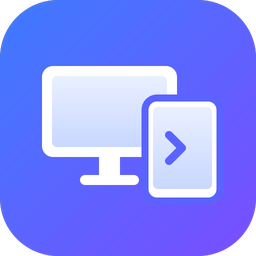
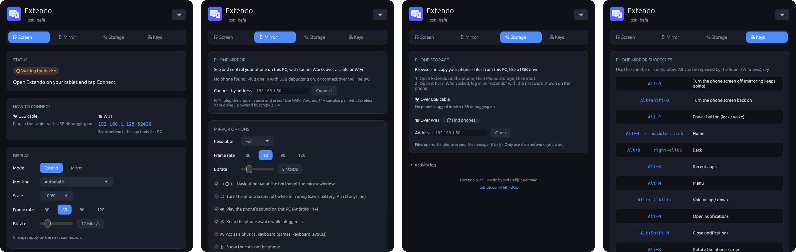
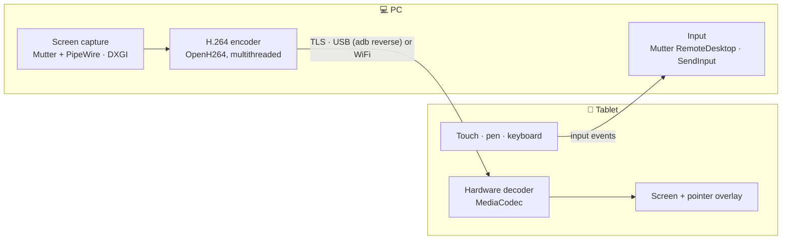

<div align="center">



# Extendo

**Turn your Android tablet into a second monitor for your Windows or Linux PC, over a USB cable or WiFi.**

[](https://github.com/Hafij-BGE/Second-monitor/releases/latest)
[](https://github.com/Hafij-BGE/Second-monitor/releases)


[Download](#download) · [Quick start](#quick-start) · [Features](#features) · [Security](#security) · [Build](#build-from-source)

<br>



</div>

## Features

|  |  |
|---|---|
| 🖥️ **Real extend or mirror** | A true extra monitor sized for the tablet: GNOME's virtual monitor on Linux, a virtual display driver on Windows (one-click setup). Or mirror any existing screen. |
| 🔌 **USB or WiFi** | USB runs through `adb` for the lowest latency. On WiFi the tablet finds the PC by itself. Reconnects automatically. |
| 👆 **Touch, trackpad and pen** | Touch the PC directly, or switch to trackpad mode: tap to click, two-finger tap to right-click, two-finger scroll, hold to drag. A stylus or mouse always points directly. |
| ⌨️ **Keyboard and shortcut bar** | On-screen and hardware keyboards, plus a sidebar with Ctrl, Alt, Shift, Super, Esc, Tab, undo, cut, copy and paste. |
| 📋 **Clipboard sync** | Copy on one device, paste on the other. |
| 📁 **File transfer** | Drop files on the PC window, use the tablet sidebar, or *Share → Send to PC* from any Android app. |
| 🎚️ **Resolution, scale and quality** | Pick the resolution, scale everything up, and choose Smooth, Low-latency or Sharp, or set your own frame rate (30–120) and bitrate. |
| 🖱️ **Lag-free pointer** | The tablet draws the mouse pointer itself, so it moves without waiting for the video. Optional performance overlay. |
| 📱 **Extendo Mirror** | See and control your phone on the PC with sound, over cable or WiFi, with a Back / Home / Recents bar under the window. Turn the phone screen off while mirroring continues. |
| 🗂️ **Phone storage** | Browse and copy the phone's files from the PC's own file manager, like a USB drive. |
| 🌙 **Runs in the background** | Closing the window keeps Extendo ready for tablets, with a tray icon (Open / Quit). Optionally starts hidden when you log in. |

## Download

Get the latest build from **[Releases](https://github.com/Hafij-BGE/Second-monitor/releases)**.

| Platform | Package |
|---|---|
| **Windows 10 / 11** | [Installer `.exe`](https://github.com/Hafij-BGE/Second-monitor/releases/download/v0.2.4/extendo-0.2.4-windows-x64-setup.exe) · [Portable `.zip`](https://github.com/Hafij-BGE/Second-monitor/releases/download/v0.2.4/extendo-0.2.4-windows-x64-portable.zip) |
| **Ubuntu 26.04** | [`.deb`](https://github.com/Hafij-BGE/Second-monitor/releases/download/v0.2.4/extendo_0.2.4-1_amd64.deb) |
| **Ubuntu 24.04, Mint 22** | [`.deb`](https://github.com/Hafij-BGE/Second-monitor/releases/download/v0.2.4/extendo_0.2.4-1.ubuntu24.04_amd64.deb) |
| **Fedora 42+** | [`.rpm`](https://github.com/Hafij-BGE/Second-monitor/releases/download/v0.2.4/extendo-0.2.4-1.fc42.x86_64.rpm) |
| **Arch, Manjaro, EndeavourOS** | [`.pkg.tar.zst`](https://github.com/Hafij-BGE/Second-monitor/releases/download/v0.2.4/extendo-0.2.4-1-x86_64.pkg.tar.zst) |
| **Any Linux (glibc 2.39+)** | [AppImage](https://github.com/Hafij-BGE/Second-monitor/releases/download/v0.2.4/Extendo-0.2.4-x86_64.AppImage) · [Portable `.tar.gz`](https://github.com/Hafij-BGE/Second-monitor/releases/download/v0.2.4/extendo-0.2.4-linux-x86_64.tar.gz) |
| **Android 7+** | [`.apk`](https://github.com/Hafij-BGE/Second-monitor/releases/download/v0.2.0/extendo-0.2.0-android.apk) |

> [!NOTE]
> On Linux the PC side needs **GNOME** (Wayland or X11). Every release has a `SHA256SUMS.txt` to check the files.

## Quick start

1. **Install Extendo** on the PC and open it.
2. **Install the APK** on the tablet and open it.
3. **Connect** one of two ways:
   - **USB:** on the tablet, turn on *Developer options → USB debugging*, plug it in, accept the prompt, then tap **Connect over USB**. The PC needs `adb` (`sudo apt install adb` on Linux; on Windows put Android platform-tools next to `extendo.exe`).
   - **WiFi:** put both on the same network and tap your PC in the list. Check that both screens show the same 6-digit code, then allow the tablet on the PC.

> [!TIP]
> The Windows installer opens the firewall for you. With `ufw` on Linux, run:
> ```bash
> sudo ufw allow 52020/tcp && sudo ufw allow 52021/udp
> ```

### Extending on Windows

Windows needs a virtual monitor to extend onto. In the **Display** card, click **Set up extend** once. Extendo downloads Parsec's signed [Parsec Virtual Display Driver](https://github.com/nomi-san/parsec-vdd) 0.41, checks the file and installs it (Windows asks for admin approval).

After that, Extendo plugs in a virtual monitor while a tablet is connected and unplugs it afterwards. If Extendo closes or crashes, the driver removes the monitor by itself within a second. It also works when *Win+P* is set to Duplicate.

- If the tablet shows black bars because its size is missing, click **Add *width*×*height*** in the Display card.
- To remove the driver, uninstall it from *Windows Settings → Apps*.
- Extendo still uses [Virtual Display Driver](https://github.com/VirtualDrivers/Virtual-Display-Driver) if that is installed instead.

### Mirror shortcuts

<details>
<summary>Keys for the phone mirror window (also listed in the <b>Keys</b> tab)</summary>

<br>

Alt can be replaced by the Super (Windows) key.

| Keys | Action |
|---|---|
| `Alt+O` | Turn the phone screen off (mirroring keeps going) |
| `Alt+Shift+O` | Turn the phone screen back on |
| `Alt+P` | Power button (lock / wake) |
| `Alt+H` · middle-click | Home |
| `Alt+B` · right-click | Back |
| `Alt+S` | Recent apps |
| `Alt+M` | Menu |
| `Alt+↑` / `Alt+↓` | Volume up / down |
| `Alt+N` / `Alt+Shift+N` | Open / close notifications |
| `Alt+R` | Rotate the phone screen |
| `Alt+←` / `Alt+→` | Rotate only the mirror window |
| `Alt+Z` / `Alt+Shift+Z` | Freeze / unfreeze the picture |
| `Ctrl`+drag | Pinch to zoom and rotate |
| Right-click (screen off) | Wake the phone |
| `Alt+F` | Fullscreen |
| `Alt+G` | Pixel-perfect size (1:1) |
| `Alt+W` | Fit the window, remove black bars |
| `Alt+C` / `Alt+X` | Copy / cut on the phone |
| `Alt+V` | Paste the PC clipboard on the phone |
| `Alt+Shift+V` | Type the PC clipboard as text |
| `Alt+I` | Show the frame rate in the terminal |
| Drag an `.apk` onto the window | Install the app on the phone |
| Drag any file onto the window | Copy it to the phone's Download folder |

</details>

## Security

| | |
|---|---|
| 🔒 **Encrypted** | All traffic between the tablet and the PC uses TLS. |
| 🤝 **Pairing** | A new tablet on WiFi must be allowed on the PC, and both screens show the same 6-digit code. A different code means someone is intercepting. Trusted tablets are listed under *Screen → Security* and can be removed. USB connections are always allowed. |
| 🔌 **USB only** | One switch closes the PC's network port completely. |
| 🗂️ **Phone storage** | Off until you start it. Uses an 8-digit password, locks for 5 minutes after 5 wrong passwords, allows at most 4 connections, stops after 15 idle minutes, and can be limited to the USB cable. |
| 📶 **WiFi mirroring** | Opens the phone's adb port. *Turn off WiFi* in the Mirror tab closes it again. |

> [!WARNING]
> FTP (phone storage) is not encrypted. Use its WiFi access only on networks you trust.

## Command line

The PC app opens a window by default. For a terminal-only setup:

```text
extendo --background                # start with the window closed (tray icon)
extendo --headless [--mode extend|mirror] [--monitor NAME] [--fps 60]
                   [--bitrate 12] [--scale 1.5] [--port 52020] [--no-usb] [--no-discovery]
extendo --list
```

Closing the window keeps Extendo running in the background; turn this off under *Screen → Options*, or quit from the tray icon or the **Quit Extendo** button. Starting Extendo again opens the window of the copy already running. On GNOME the tray icon needs the AppIndicator extension (included in Ubuntu).

Settings are saved in `~/.config/extendo/settings.json` (Linux) or `%APPDATA%\extendo` (Windows). Received files go to `Downloads/Extendo`.

## How it works



The PC sends only changed frames, encodes them in slices on several threads and streams them over TCP. The tablet decodes with its hardware decoder and draws the mouse pointer on top. The wire format is described in [docs/protocol.md](docs/protocol.md).

## Build from source

<details>
<summary><b>PC app on Linux</b></summary>

```bash
sudo apt install libpipewire-0.3-dev libspa-0.2-dev libclang-dev clang pkg-config nasm
cd host
cargo build --release
cargo install cargo-deb && cargo deb
```

AppImage, RPM, Arch and Ubuntu 24.04 packages are built in containers by the scripts in [`host/packaging/linux/`](host/packaging/linux/).

</details>

<details>
<summary><b>PC app for Windows</b></summary>

Cross-compile from Linux:

```bash
sudo apt install gcc-mingw-w64-x86-64 g++-mingw-w64-x86-64
cd host
cargo build --release --target x86_64-pc-windows-gnu
```

On Windows itself, run `cargo build --release`.

</details>

<details>
<summary><b>Android app</b></summary>

Needs JDK 17 and the Android SDK:

```bash
cd android
gradle assembleRelease
```

Without signing secrets, CI signs the APK with a throwaway key, so each build must be uninstalled before the next one is installed. For in-place updates, add the repository secrets `ANDROID_KEYSTORE_BASE64`, `ANDROID_KEYSTORE_PASSWORD`, `ANDROID_KEY_ALIAS` and `ANDROID_KEY_PASSWORD`.

</details>

GitHub Actions builds every format on each push to `main`.

## Credits

Extendo is designed and built by **[Md Hafijur Rahman](https://github.com/Hafij-BGE)**.

Licensed under the MIT license (see [LICENSE](LICENSE)); third-party credits are in [THIRD_PARTY_NOTICES.md](THIRD_PARTY_NOTICES.md).

Built with [egui](https://github.com/emilk/egui), [OpenH264](https://github.com/cisco/openh264), [rustls](https://github.com/rustls/rustls) and Jetpack Compose. Extendo Mirror is based on [scrcpy](https://github.com/Genymobile/scrcpy) (Apache 2.0). Windows extend uses [Parsec Virtual Display Driver](https://github.com/nomi-san/parsec-vdd).
